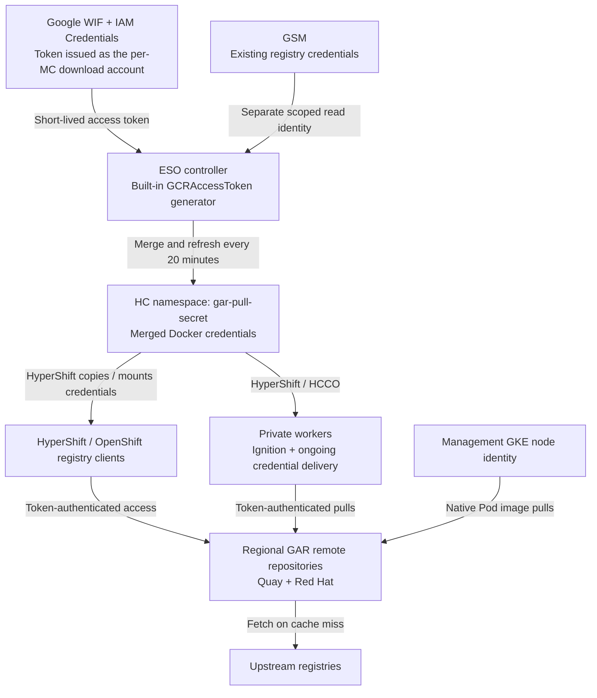

# Deliver OpenShift Release Images Through GAR Without Public Worker Egress

***Scope***: GCP-HCP

**Date**: 2026-10-23

**Status**: Proposed — based on a working development POC; production rollout is subject to the acceptance gates below.

**Related work**: [GCP-738](https://redhat.atlassian.net/browse/GCP-738), [GCP-1268](https://redhat.atlassian.net/browse/GCP-1268).

## Decision

Deliver OpenShift release images through regional Google Artifact Registry (GAR) pull-through caches with no public worker egress, using External Secrets Operator (ESO) and Workload Identity Federation (WIF) for keyless credential renewal with a Google identity per management cluster.

## Context

This proposal extends the existing [image-distribution decision](../automation/container-image-build-and-distribution-pipeline.md) to private workers and in-process registry clients. It does not change the Konflux build/publish pipeline or approve unrestricted production deployment of the prototype.

Introduce the new credentials alongside the original pull secret, and activate workers before control-plane image routing and worker egress restrictions.

### Problem statement

Private hosted-cluster workers must bootstrap, scale and upgrade without external IPs or Cloud NAT. OpenShift release images normally reference external registries, while some HyperShift and OpenShift components authenticate through Docker configuration files rather than native Google identity. These consumers need both a reachable GAR image source and credentials that remain usable as Google access tokens expire.

The existing GKE node-IAM and MutatingAdmissionPolicy approach covers management-cluster Pod image downloads. Pod admission cannot redirect a Go registry client's HTTP requests or configure a separate worker's container runtime. WIF can generate credentials for these consumers, but does not make their current file-based interfaces identity-aware.

### Scope, constraints and assumptions

- **Included:** release-image downloads for hosted control planes and workers; release metadata extraction; API server image imports used to validate authentication; private worker bootstrap, scaling and ongoing renewal.
- **Outside the initial scope:** customer workload images, complete Operator Hub and layered-product coverage, image-build changes, and full management-cluster egress restriction. Catalog routing remains exploratory.
- **Network requirement:** workers have no external IP or Cloud NAT, while retaining Private Google Access and required DNS, Google API and cluster connectivity. GAR may fetch upstream content on cache misses; this is not an offline image inventory.
- **Identity requirement:** no Google service-account JSON keys. Each management cluster (MC) generates its own credentials, with exact HostedCluster (HC) namespace identity bindings and no cross-MC credential exchange.
- **Compatibility requirement:** keep existing clusters functional at every delivery stage. Secret-name, bootstrap or mirror changes may require a one-time rollout; routine token changes must not replace worker VMs.
- **Assumptions:** native GKE node IAM remains available for Pod pulls, and supported ESO/HyperShift versions provide the required token-generation and credential-delivery interfaces; pin and validate those versions before activation.

## Proposed Architecture

### Repositories and access

The production baseline proposed for review is one regional remote repository per upstream registry, initially Quay and `registry.redhat.io`. Configure each consumer's source-to-destination mapping explicitly. One Google access token can access both repositories when its identity has the required IAM grants.

Direct regional remote destinations still need equivalent validation; the tested POC topology and the virtual-repository trade-off are described under [Alternatives Considered](#alternatives-considered).

GAR's credentials for reading upstream registries are stored in Google Secret Manager (GSM). They are separate from the Google OAuth tokens used by cluster consumers to read GAR.

The diagram shows the proposed regional topology. HCCO is the Hosted Cluster Config Operator.

| Permission | Purpose and owner |
| --- | --- |
| HC Kubernetes ServiceAccount → MC Google download account: `roles/iam.workloadIdentityUser` | Allows Google-account impersonation. Gecko creates the exact namespace/account `IAMPolicyMember`; Config Connector applies it. |
| MC download account → GAR repositories: `roles/artifactregistry.reader` | Authorizes image access using the generated token. Infrastructure owns the shared account and grants. |
| GSM-reader Kubernetes identity → required GSM secrets: `roles/secretmanager.secretAccessor` | Reads the base registry credentials through a namespace-scoped SecretStore, using direct WIF as required by the secret-management decision. This is separate from the GAR impersonation identity. |
| Management GKE node identity → regional GAR | Preserves native Pod image pulls and the existing pipeline's project-level reader-grant model. |

### Credential generation

The POC adds four GAR-specific resources in each opted-in HC namespace: the `gar-token-generator` ServiceAccount, its WIF `IAMPolicyMember`, the `GCRAccessToken/gar-token` generator configuration, and the `ExternalSecret/gar-pull-secret` merge instructions.

For production, Gecko's per-HC resource delivery must also provide a namespace-scoped SecretStore and a separately authorized GSM-reader Kubernetes ServiceAccount, with its secret-access grant reconciled through Config Connector. These are application resources; Terraform provisions the underlying shared GSM secrets and foundational IAM prerequisites. Validate direct-principal GSM access in the selected ESO version before activation.

On each scheduled refresh, ESO:

1. Uses its Kubernetes RBAC to request a token for the referenced HC ServiceAccount through the TokenRequest API.
2. Exchanges that Kubernetes identity with Google and calls IAM Credentials `generateAccessToken` for the MC download account.
3. Reads the base registry credentials through its separately authorized GSM path.
4. Preserves the base registry entries, adds GAR authentication and writes a complete `kubernetes.io/dockerconfigjson` Secret named `gar-pull-secret`.

Token retrieval is built into ESO; no custom token service is introduced. The generated OAuth token is written directly to Kubernetes, never stored in GSM. The original pull-secret resource remains alongside the new merged Secret.

Keep the POC's **20-minute refresh** and default **one-hour token lifetime** initially. Each refresh obtains a replacement while the previous token should still be valid; it does not wait for expiration. This schedule is not an expiry guarantee.

### Delivery and image routing

The prototype selects `gar-pull-secret` using `HostedCluster.spec.pullSecret.name`. HyperShift copies it into the hosted control-plane (HCP) namespace as `pull-secret`; HCCO maintains the guest `openshift-config/pull-secret` and `kube-system/original-pull-secret` copies. The eligible worker syncer writes changed credentials to `/var/lib/kubelet/config.json`. Ignition-server cache invalidation supplies current credentials to new workers.

The prototype's `hypershift.openshift.io/gcp-pull-secret-refresh` annotation enables GCP-specific refresh behavior. A component-scoped hash exception allows the OpenShift API server's mounted credentials to update without a token-driven Pod rollout. Other configuration still triggers normal rollouts. The worker syncer similarly omits the credential-content hash from its Pod template when opted in; **it still restarts the kubelet service after changing the file**.

Credential delivery and registry routing are separate:

| Consumer | Route to GAR | Authentication |
| --- | --- | --- |
| Management/HCP Pod image downloads | Scoped `gar-image-rewriter` MutatingAdmissionPolicy | GKE node IAM |
| HyperShift in-process registry clients | `--registry-overrides` | Selected Docker credentials |
| Worker image downloads | `imageContentSources` / CRI-O digest mirrors | Delivered worker credential file |
| API server image imports | Configured GAR references or registry mappings | Mounted Docker credentials |

The reload declaration follows the Secret actually mounted by the API server. No credential-cache modification was needed in the matched deployed revision; the release-specific compatibility requirement is listed under [Consequences](#consequences).

## Alternatives Considered

| Approach | How it works | Selection and rationale |
| --- | --- | --- |
| **Direct regional remote repositories** | One pull-through cache per upstream registry; consumers map each source to its regional GAR destination. | **Proposed production topology.** Follows the approved image-pipeline decision and preserves source separation; equivalent end-to-end validation remains required. |
| **ESO + WIF + renewed pull secret** | ESO mints short-lived Google tokens and merges them into credentials delivered by HyperShift. | **Proposed credential bridge.** Reuses an existing generator and consumer interfaces; expiry-aware delivery, recovery and reload remain acceptance gates. |
| Virtual repository consolidation | Presents the two remote repositories through one registry endpoint; tested in the POC's management project. | **Not selected for production.** Conflicts with the approved pipeline decision's exclusion of virtual repositories. Direct regional remotes are the baseline; retaining a virtual layer would require a decision revision. |
| Worker VM identity + kubelet credential provider | A Google provider obtains GAR credentials on demand from the worker's attached identity, with bounded caching. | **Future direction for removing distributed GAR tokens from steady-state worker pulls.** Validate the exact runtime, mirror authentication and bootstrap behavior before adoption; see below. |
| Worker runtime credential helper | Fetches credentials on demand at the runtime layer. | **Deferred alternative.** Needs supported RHCOS/CRI-O integration, bootstrap coverage and lifecycle ownership. |
| Long-lived Google service-account key in GSM | Stores a persistent key for consumers to authenticate to Google. | **Rejected.** Conflicts with the no-keys direction and introduces key storage, rotation and retirement. |
| Longer-lived access tokens | Requests up to 12 hours with the required organization policy and explicit lifetime. | **Optional investigation.** ESO support and GAR behavior need testing; a 20-minute refresh still causes roughly 72 credential changes/day. |
| Manual-only rotation | Operators generate and distribute replacement credentials. | **Rejected for routine renewal.** Short-lived credentials require continuous automation; retain a supported force-refresh procedure for recovery and controlled tests. |

### Future worker authentication without a GAR pull secret

The target to investigate is a worker VM identity with GAR Reader access plus the [Google kubelet credential provider](https://github.com/openshift/cloud-provider-gcp). HyperShift's Azure [`containerRegistry` managed-identity configuration](https://github.com/openshift/hypershift/blob/main/api/hypershift/v1beta1/azure.go) provides API design precedent for worker pulls without image pull secrets.

Before replacing the worker GAR credential path:

- Verify the provider binary and configuration in the exact RHCOS release; its availability in upstream code does not establish deployment readiness.
- Prove mirror authentication. Kubelet's [`matchImages` configuration](https://kubernetes.io/docs/tasks/administer-cluster/kubelet-credential-provider/) matches the requested image, while IDMS/CRI-O can select a different GAR mirror. Configuring a provider for `*.pkg.dev` alone does not establish that credentials reach the actual mirror. Investigate [OCPSTRAT-3945](https://issues.redhat.com/browse/OCPSTRAT-3945), confirming its scope and target-release applicability before treating it as a delivery dependency.
- Audit bootstrap and any image access before the provider is usable; validate fresh-worker creation as well as steady-state pulls.

Control-plane Go registry clients do not invoke kubelet's provider. Their native Google-identity integration is a separate track and does not need to block eliminating the worker's distributed GAR token. The ESO approach is the proposed bridge while these consumer-specific paths are investigated.

## Decision Rationale

**Justification:** ESO supplies the token-generation capability and HyperShift already has pull-secret delivery paths. Extending those paths provides an incremental way to support private workers and registry clients while retaining native GKE IAM where it already works. It avoids introducing a separate token service or Google account keys.

**Comparison:** Native identity is simpler for compatible consumers, but switching every bootstrap/runtime/library interface is a separate investigation. The pull-secret bridge can be delivered incrementally, provided freshness and service-restart risks are resolved before production activation.

**Evidence:** The following are bounded development observations from 22–23 October 2026, not production SLOs or repeatable CI acceptance results. They summarize local POC investigation records; the full reports and logs are not included in this change. The prototype links below identify implementation snapshots, not independent records of these measurements. Publish reproducible evidence with the acceptance work before production activation.

| Observation | Result and limit |
| --- | --- |
| Private workers | Bootstrap and scale 1 → 2 → 1 succeeded without external IPs or Cloud NAT. Six uncached release-image pulls passed across renewals. This does not prove every alternative egress path is blocked. |
| API server stability | The same three Pod identities remained overnight with zero container restarts. Another mounted ConfigMap change still triggered a normal rollout. |
| Authenticated imports | All replicas passed earlier probes after the baseline token's expected expiry. Later probes had GAR connection/header timeouts and only two of three replicas eventually succeeded; the cause remains open. |
| Propagation | Nine copies first matched after 55.5 and 76.1 seconds in sampled two-worker checks. These are not percentiles or guaranteed bounds. |
| Worker syncer Pod stability | The later fix preserved one syncer Pod across one scheduled and one manual renewal. Observations from ESO's status-refresh timestamp to the syncer's file-write log were 81 and 74 seconds, not issuer-to-consumer latency measurements. A longer scheduled soak remains necessary. |
| Worker service impact | Kubelet still restarted after both later updates. The earlier overnight journal recorded 50 restarts across 49 renewal windows. Worker identity/boot ID stayed unchanged; application traffic continuity was not measured. |

The old token was not retained until issuer-confirmed rejection. These results support normal renewal and in-place API server reload; they do not establish expiry enforcement or outage recovery.

## Consequences

### Positive

- Release images are reachable through GAR without worker public IPs or Cloud NAT.
- Keyless token generation reuses ESO; existing registry credentials and the original pull secret are preserved.
- In-place updates can avoid routine API server/syncer Pod replacement and token-driven worker VM replacement.
- Infrastructure preparation and consumer activation can be reviewed and deployed separately.

### Negative

- Google identity APIs, ESO, GSM and several controllers become dependencies in a time-bounded delivery chain.
- Expiry metadata and minimum-validity enforcement are not present end to end in the prototype.
- Worker kubelet restarts remain an operational issue; a longer token lifetime alone does not reduce them.
- Release compatibility needs revalidation: the tested 4.22.17 API server mounts `pull-secret`, while newer reviewed HyperShift source mounts `combined-pull-secret`. The hash exception must match the actual mount, and the additional merge hop needs credential-adoption and timing tests.
- The POC exposed a separate GCP API credential-path issue in cloud-network-config-controller (CNCC): a temporary `GOOGLE_APPLICATION_CREDENTIALS` patch pointed it at an existing WIF/ADC file. A permanent source/GitOps fix and component-specific credential audit remain follow-ups; GAR pull-secret renewal does not configure these Google API clients.
- Per-HC bindings and credential copies add reconciliation, quota, monitoring and cleanup work. A shared per-MC Google identity also creates a common authorization boundary across its opted-in HCs.

## Cross-Cutting Concerns

### Reliability

Before production activation, preserve Google's actual expiration timestamp with the matching credential throughout the required delivery paths. The reviewed ESO v2.2.0 impersonation helper drops that timestamp; pin a verified fixed version or change before relying on generator expiry. A stored Ready condition or retained Secret is not proof of current validity.

Measure generation, per-hop delivery and worker reload latency across multiple cycles. Define a budget covering retries, propagation, minimum bootstrap validity, clock allowance and safety margin. The nominal 40 minutes remaining at the first normal refresh is shared by these operations, not a delivery guarantee.

Require independent freshness/deadline alerts, visible startup waits for IAM/Secret readiness, and a defined response when minimum validity is lost. Gate new bootstrap/provisioning on sufficient validity; test stale ignition caches and disconnected workers. Retaining the last complete Secret during a source failure must not allow it to be considered valid past expiry.

### Security

- Use exact namespace/Kubernetes-account WIF bindings and read-only GAR access. Preserve the separate GSM access boundary and namespace-scoped SecretStores; the POC's reused ClusterSecretStore is not the proposed production model.
- Record secret sources, producers, consumers and runbooks in the existing secret inventory. Store metadata only; never log tokens or Docker authentication data.
- Restrict TokenRequest, Secret, ExternalSecret and generator access through RBAC. WIF avoids persistent Google keys, but distributed OAuth tokens remain bearer credentials until expiry.
- Test worker network restrictions from both nodes and Pods. Preserve only required Google/cluster connectivity and verify direct upstream access cannot bypass GAR mirrors. Management-cluster network restriction is separate work.

### Performance

At a nominal 20-minute interval, each opted-in HC has 72 generation cycles/day, shared by its workers. A cycle involves multiple requests and may retry. Measure IAM quotas, reconciliation queues, synchronized bursts and GSM access volume at fleet density; add jitter or capacity controls as needed.

### Cost

[IAM API usage is currently free](https://cloud.google.com/iam/pricing); quota and availability limits still apply. Budget [regional GAR storage and data transfer](https://cloud.google.com/artifact-registry/pricing), [GSM secret versions and access operations](https://cloud.google.com/secret-manager/pricing), and monitoring/logging usage. Per-HC generator resources and IAM bindings add reconciliation and operational load on existing controllers. Set numerical budgets from measured fleet demand before expansion.

### Operability

Terraform owns foundational repositories, shared MC download accounts and shared IAM. ArgoCD deploys ESO, Gecko, HyperShift and routing configuration; Gecko's normal resource-delivery path creates per-HC resources, with Config Connector reconciling the application-scoped IAM binding. Avoid dual ownership of an IAM grant.

Keep creation separate from activation: the prototype's `enabled: true` with `selectForHostedClusters: false` prepares the new resources while preserving the original selection. The shared selection switch is not a worker-only rollout mechanism.

For rollback, keep renewal running until a reachable, authenticated replacement path is verified. Restore credential selection and image routing together, including existing workers and new bootstrap. `selectForHostedClusters: false` alone is not a validated rollback; the original Secret cannot authenticate to GAR and public upstream fallback may be blocked.

Gecko-managed HC teardown must remove generated resources and the exact WIF binding after Config Connector finalizers complete. Deleting only the HyperShift HostedCluster object does not remove the user-selected management-cluster source Secret or Gecko-owned IAM binding. Shared repositories and MC identities remain infrastructure-owned. Test the full deletion path; force-removing finalizers may orphan bindings.

## Incremental Delivery and Acceptance

Every task must leave a usable, reconciled setup. Task labels below are proposed Jira work items, not created issues. Each activation stage needs a canary, health checks and a tested rollback before expansion.

### Epic 1 — GAR foundation and automatically renewed management-cluster credentials

**Exit:** regional GAR and a valid, monitored new pull secret exist in the management cluster. Existing consumers continue using their original selection and routes.

| Task | Deliverable and working state after completion |
| --- | --- |
| E1.1 — Provision regional GAR | Create direct remote repositories and upstream authentication. An isolated identity can fetch an uncached release image; cluster image paths remain unchanged. |
| E1.2 — Configure keyless access | Establish MC download identity, reader grants, IAM Credentials API, scoped GSM access and a pinned ESO generator. An isolated token request and GAR read succeed; existing ESO resources keep working. |
| E1.3 — Generate credentials alongside the original | Gecko creates the per-HC identity, binding, generator and ExternalSecret with selection off. A complete merged Secret renews while consumers remain unchanged. |
| E1.4 — Add freshness and recovery safeguards | Preserve trustworthy issuer expiry, expose readiness/delivery state and alert before the deadline. Isolated WIF/GSM failures retain the last complete Secret without publishing partial credentials; recovery is measured across multiple lifetimes. |

### Epic 2 — Consumer rollout, worker egress restriction and operational readiness

**Exit:** workers and scoped control-plane consumers use GAR under repeatable validation, with worker public egress blocked and runbooks available.

| Task | Deliverable and working state after completion |
| --- | --- |
| E2.1 — Roll out to workers | Define worker-specific activation and delivery before enabling canaries. Prove bootstrap, renewal, uncached pulls, scaling and rollback; expand in batches. Remove kubelet restarts only after live file reload is proven with an unchanged kubelet process and no alternative credential masking. |
| E2.2 — Roll out to control-plane elements | Enable registry overrides and scoped Pod rewriting incrementally. Validate the actual mounted Secret, all API server replicas after baseline-token rejection, native GKE Pod pulls and continued rollout for other configuration. Resolve the observed GAR timeouts before expansion. |
| E2.3 — Restrict worker egress | Remove external IP/NAT paths and deny public destinations while preserving required Google, DNS and cluster access. Canary bootstrap, renewal and uncached GAR pulls still pass; direct upstream access fails. |
| E2.4 — Add resilience and zero-egress e2e tests | Automate multiple renewals, old-token rejection, fresh bootstrap, scaling, upgrades, component/source outages and rollback. Node/Pod probes verify required access succeeds and alternate public egress fails. |
| E2.5 — Clean up implementation | Remove obsolete prototype configuration and unused resources after reference checks. Verify redeployment, HC teardown and IAM/finalizer cleanup; preserve required base credentials and rollback until migration is accepted. |
| E2.6 — Document operations | Publish configuration, identity/network dependencies, monitoring, on-demand refresh, rollout/rollback and reproducible test evidence. An operator can deploy and diagnose the supported flow from versioned instructions. |

**Worker-first prerequisite:** HostedCluster currently has one `spec.pullSecret` reference, and the POC's shared switch also affects control-plane resources. Separate routing flags alone do not isolate credential updates. E2.1 must define a worker delivery/activation contract; shared control-plane reload preparation may need to land before worker activation even though control-plane GAR routing follows in E2.2.

Changes to credential references, mirrors or bootstrap inputs must be reviewed for existing-fleet rollout impact. If NodePool hash inputs change, satisfy HyperShift's required `e2e-aws-upgrade-hypershift-operator` check. Routine token bytes must stay outside replacement hashes.

## Relationship to Existing Decisions

| Decision | Relationship |
| --- | --- |
| [Image build and distribution](../automation/container-image-build-and-distribution-pipeline.md) | Extends regional GAR access beyond native GKE Pod pulls. Keeps direct remote repositories as the proposed production baseline; the POC virtual layer is not approved by this record. |
| [Workload Identity](../identity/workload-identity-implementation.md) | Uses keyless token exchange; retains native node IAM for kubelet pulls, distinct from application registry-client authentication. |
| [Secret management](../identity/secret-management-strategy.md) | Uses scoped SecretStores and direct WIF for GSM. Generated tokens are runtime credentials in Kubernetes; register the flow and metadata in the secret inventory. |
| [Regional independence](regional-independence-architecture.md) | Places caches regionally and token-generation identity per MC, with no cross-MC credential dependency. Uncached content still depends on upstream availability. |
| [Deployment swim lanes](../automation/deployment-tooling-swim-lanes.md) | Keeps foundational infrastructure in Terraform and application/controller resources in the existing GitOps and reconciliation paths. |

## References

Prototype snapshots are reference implementations on development forks, not merged upstream changes:

- [Gecko resource generation and selection — f65b380](https://github.com/daniel-rejniak/gecko/commit/f65b38073d731fa13eec3513f6084a89a61754e3).
- [HyperShift guest/worker delivery and ignition refresh — 472dc51](https://github.com/daniel-rejniak/hypershift/commit/472dc51313d1a06ed0082ffd8f086b3503aa6da6).
- [Release-matched API server reload — bdf9b66](https://github.com/daniel-rejniak/hypershift/commit/bdf9b66b5af9e10be3a96e8cd966b1130ec7d8f7); [later syncer Pod stability — 54de435a8](https://github.com/daniel-rejniak/hypershift/commit/54de435a8).
- [Development infrastructure snapshot — 70e5ef9](https://github.com/daniel-rejniak/gcp-hcp-infra/commit/70e5ef959fdd1297da381750b3eeb4241270ae1d); [later deployment pins — c4fa942c](https://github.com/daniel-rejniak/gcp-hcp-infra/commit/c4fa942c).
- [Matched deployed API server source — 77f4eab](https://github.com/openshift/openshift-apiserver/commit/77f4eab69952824801ecc4113666a5e87684c899).
- [ESO GCRAccessToken generator](https://external-secrets.io/latest/api/generator/gcr/); [reviewed v2.2.0 Workload Identity helper](https://github.com/external-secrets/external-secrets/blob/v2.2.0/providers/v1/gcp/secretmanager/workload_identity.go).
- [Google access-token API and lifetime limits](https://docs.cloud.google.com/iam/docs/reference/credentials/rest/v1/projects.serviceAccounts/generateAccessToken); [GAR remote repositories](https://docs.cloud.google.com/artifact-registry/docs/repositories/remote-overview).
